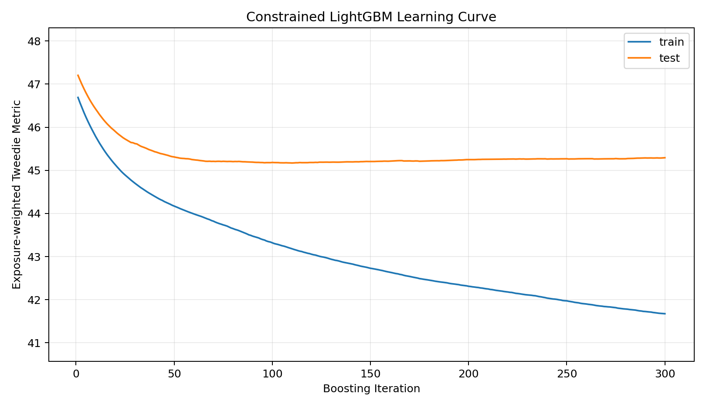

# PS4 Exercise 2 — Learning Curve

## 1. Model configuration

I refitted the constrained LightGBM model using the best parameters selected through training-only cross-validation in Exercise 1. The learning rate was 0.03, and the number of estimators was 300.

The same fixed data split was used, with 542,286 training observations and 135,727 test observations. The preprocessing pipeline was fitted on the training data and then applied to both samples. Exposure weights were used for model training and evaluation. The increasing monotonicity constraint on BonusMalus was retained.

Both the training and test samples were passed to `eval_set`, with their corresponding Exposure weights. The Tweedie metric was recorded at each boosting iteration, and the learning curve was generated using `lgb.plot_metric()`.

## 2. Learning curve and convergence



Both the training and test metrics decreased substantially during the early iterations. The training metric decreased from 46.690013 at iteration 1 to 43.319051 at iteration 100, and eventually reached 41.674999 at iteration 300.

The test metric reached its minimum value of 45.169876 at iteration 110. After this point, it generally increased slightly and reached 45.292159 at the final iteration.

The improvement in the training metric became smaller over time, suggesting that the model was gradually approaching convergence. However, the training metric was still decreasing at iteration 300.

## 3. Overfitting

The learning curve shows signs of mild overfitting after approximately 110 boosting iterations.

The training metric continued to decrease, while the test metric gradually increased. Between iterations 250 and 300, the training metric decreased by 0.298820, but the test metric increased by 0.023796.

This suggests that additional boosting iterations improved the fit to the training data without improving generalisation on the test data.

The final Exposure-weighted Tweedie deviances were:

| Metric | Value |
|---|---:|
| Training deviance | 67.373712 |
| Test deviance | 74.469452 |
| Train-test deviance gap | 7.095740 |

These results are consistent with Exercise 1.

The LightGBM Tweedie metric used in the learning curve and the mean Tweedie deviance used for the final model comparison have different numerical definitions.

## 4. Assessment of the selected parameters

The selected parameters allow the model to learn effectively during the early iterations. However, the learning curve suggests that 300 estimators may be more than necessary for this particular test sample.

Although the lowest observed test metric occurred at iteration 110, I retained the original 300 estimators because this configuration was selected through cross-validation in Exercise 1.

The test curve is used only for model diagnosis, not for parameter selection or early stopping. Any further tuning should be performed using cross-validation within the training sample.

## 5. Reproduction

Run the following command from the repository root:

```bash
python -m analyses.ps3_script ps4-ex2 --data data/ps4_claims.parquet --results-dir results
```

The complete evaluation history and model configuration are available in [learning_curve_metrics.json](learning_curve_metrics.json).